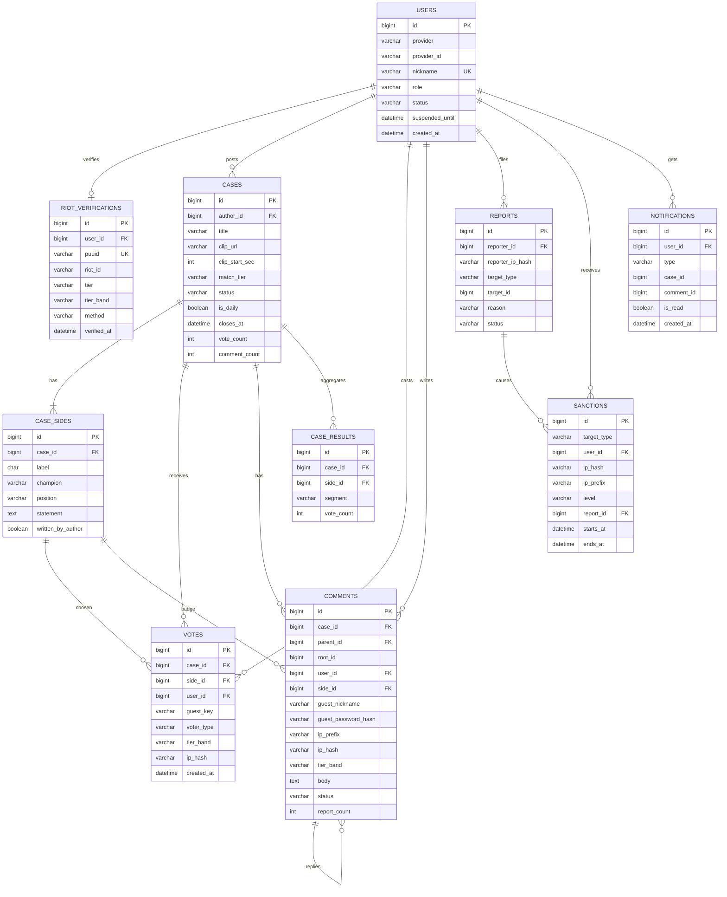

# GG-Court 설계 문서

> 배심원판 맥문철 · 리그 오브 레전드 클립 과실 판결 커뮤니티
> 버전 0.1 · 2026-11-12 · 작성: 김준혁(백엔드) / 프론트 담당 1인

> **구현 시 참고 (2026-11-25)**: 코드에서는 판결을 `verdict`로 부른다 (`case`는 Java 예약어). 이 문서의 `cases`, `case_sides`, `case_results` 테이블은 `verdicts`, `verdict_sides`, `verdict_results`로 읽는다. 기술 스택의 확정 버전은 `CLAUDE.md`, 이후 바뀐 결정은 `docs/PROGRESS.md` 결정 로그가 우선한다.

---

## 0. 문서 읽는 법

| 표시 | 의미 |
|---|---|
| ✅ 확정 | 팀이 정한 내용 |
| 💡 제안 | 설계 과정에서 나온 추천안. 팀 확인 필요 |
| ⏸ 보류 | 아직 정하지 않은 내용 |

---

## 1. 개요

### 1.1 한 줄 소개
롤 플레이 클립을 올리면, 배심원(다른 유저)이 **"누가 더 잘못했는지"** A/B로 판결하고, 결과를 **티어 구간별로** 보여주는 커뮤니티.

### 1.2 배경
- 맥문철(고티어에게 돈 내고 과실 판정받는 콘텐츠)을 **다수 배심원 투표**로 바꾼 버전.
- 범용 판결 커뮤니티(연애·직장 등)에서 범위를 좁혀, 이미 수요가 있는 게임 과실 판정에 집중.
- 차별점: 기존 커뮤니티(인벤, 디시 롤갤 등)에 없는 **티어 구간별 판결 결과**.

### 1.3 프로젝트 성격
| 항목 | 내용 | 상태 |
|---|---|---|
| 목적 | 포트폴리오 + 실제 운영 | ✅ |
| 인원 | 2인 (백엔드 1, 프론트 1). 디자인은 AI 활용. 서로 파트 교차 학습 | ✅ |
| 대상 게임 | 리그 오브 레전드 하나 | ✅ |
| 플랫폼 | 반응형 웹 | ✅ |
| 일정 | 본 문서 확정 후 결정 | ⏸ |

---

## 2. 사용자 유형과 권한

디시인사이드 방식을 따른다. 회원가입은 **고정닉을 원하는 사람만** 하고, 나머지는 유동(비회원)으로 이용한다.

| 기능 | 유동 (비회원) | 고닉 (회원) | 고닉 + 티어 인증 | 관리자 |
|---|---|---|---|---|
| 판결 열람 | O | O | O | O |
| 투표 | O (IP·쿠키 기준 1표) | O (계정당 1표) | O | O |
| 결과 열람 | 투표 후 | 투표 후 | 투표 후 | 항상 |
| 댓글 작성 | 투표 후 | 투표 후 | 투표 후 | O |
| 판결 등록 | X | O | O | O |
| 알림 수신 | X | O | O | O |
| 티어 구간 집계 반영 | X | X | O | - |
| 표시 이름 | 닉네임 + IP 앞 두 자리 (예: `ㅇㅇ(121.134)`) | 고정 닉네임 | 고정 닉네임 + 티어 배지 | - |
| 글 수정·삭제 | 작성 시 입력한 비밀번호 | 로그인 | 로그인 | 블라인드·삭제 |

- ✅ 티어 인증은 **원하는 사람만**. 인증하지 않아도 모든 기본 기능을 쓸 수 있다.
- 💡 결과 화면은 **전체 / 고닉만 / 티어 인증자 구간별** 세 가지 보기로 제공한다. 인증이 선택제여도 티어 구간별 결과(핵심 차별점)를 유지하기 위함.
- 💡 만 14세 미만은 회원가입 불가 (법정대리인 동의 절차 회피).

---

## 3. 핵심 규칙

| 규칙 | 내용 | 상태 |
|---|---|---|
| 투표 형식 | A 잘못 / B 잘못 양자택일. "둘 다 아님" 없음 | ✅ |
| 투표 변경 | 불가. 한 번 투표하면 끝 | ✅ |
| 결과 공개 시점 | 투표 전에는 참여 인원만, **투표 직후 공개**. 마감 후에는 비투표자도 열람 | 💡 |
| 판결 마감 | 기간제. 기본 72시간 | 💡 / ⏸ |
| 댓글 자격 | 투표한 사람만 작성. 댓글에 **투표한 진영(A/B) 배지** 표시 | ✅ |
| 대댓글 깊이 | 2단계(댓글 → 답글). 답글의 답글은 같은 단계에 `@닉네임` 멘션 | 💡 |
| 게시 권한 | 판결 등록은 고닉만 | ✅ |
| 영상 | 외부 링크 임베드만 (직접 업로드 없음) | ✅ |
| 닉네임 노출 | 디시 방식. 클립 속 다른 유저 닉네임은 가리고 업로드하도록 규칙화 | ✅ |
| 상대방 입장 | MVP는 작성자가 A·B 모두 작성, B에 "작성자가 대신 쓴 입장" 라벨. 상대방 초대 작성은 2차 | 💡 |

### 3.1 대댓글 2단계를 제안하는 이유
| 사이트 | 구조 |
|---|---|
| 디시인사이드, 유튜브, 네이버 뉴스 | 댓글 → 답글 1단계 |
| 레딧 | 깊은 트리, 일정 깊이부터 "더 보기"로 접음 |

무한 깊이의 단점
- 모바일에서 들여쓰기 때문에 본문 영역이 계속 좁아진다.
- 말싸움 스레드가 끝없이 길어진다.
- 정렬·페이징 쿼리가 복잡해진다.

---

## 4. MVP 기능 명세

MVP 범위: **판결 등록, 투표, 댓글, 신고, 게시글 랭킹, 알림, 공유카드** (+ 선택형 티어 인증, 관리자 기능)

### 4.1 판결 등록 (고닉 전용)
- 입력: 제목, 영상 링크(유튜브 우선), 영상 시작 시각, 경기 티어, 포지션 태그, A 입장(챔피언/포지션, 주장), B 입장(챔피언/포지션, 주장).
- 영상 링크는 허용 도메인만 받는다. 유튜브 외 플랫폼(치지직 등)은 임베드 지원 여부 확인 후 추가.
- 등록 즉시 게시 (사전 검수 없음). 신고로 사후 처리.
- 등록 시 마감 시각 자동 설정 (💡 기본 72시간).

### 4.2 투표
- A 또는 B 중 하나. 변경 불가.
- 중복 방지
  - 고닉: `(case_id, user_id)` 유니크.
  - 유동: `(case_id, guest_key)` 유니크. `guest_key = hash(IP + 쿠키 ID)`. VPN·IP 변경 우회는 완전히 막을 수 없음을 전제로 한다.
- 투표 시점의 투표자 유형(유동/고닉/인증)과 티어를 **스냅샷**으로 저장한다. 이후 티어가 바뀌어도 과거 집계는 변하지 않는다.
- 투표마다 즉시 집계 반영 (✅). Redis 카운터를 올리고, DB에는 투표 원본을 저장한다.
- 프론트 낙관적 업데이트(Optimistic UI)는 ⏸ 보류.

### 4.3 결과
- 열람 조건: 투표했거나, 마감됐거나, 관리자.
- 보기 3종: 전체 / 고닉만 / 티어 인증자 구간별.
- 티어 구간: 아이언~골드 / 플래티넘~에메랄드 / 다이아몬드 이상.
- 마감 후 "최종 판결" 확정 표시.

### 4.4 댓글
- 투표한 사람만 작성 가능. 작성자 옆에 투표 진영 배지(A/B).
- 유동: 닉네임 + 비밀번호 입력, IP 앞 두 자리 표시. 비밀번호는 BCrypt 해시 저장.
- 깊이 2단계 (💡). 답글의 답글은 `@닉네임` 멘션.
- 정렬: 최신순 / 공감순(공감 기능은 ⏸).

### 4.5 신고와 제재
- 신고 대상: 판결, 댓글. 유동도 신고 가능.
- 신고 N회 누적 시 자동 블라인드 → 관리자 검토 (💡 N은 운영하며 조정).
- 제재 단계 (✅)

| 단계 | 사유 예시 | 고닉 적용 | 유동 적용 |
|---|---|---|---|
| 경고 | 초기 비방성 댓글, 무관한 영상 게시, 불쾌감 유발 | 경고 알림 | 게시물 블라인드 |
| 일시 정지 | 과도한 비방, 불쾌감 유발, 경고 누적 | 기간 동안 작성·투표 불가 | IP 기간 차단 |
| 영구 정지 | 성인·불법 광고, 성희롱, 사이버 폭력 | 계정 영구 정지 | IP 영구 차단 |

### 4.6 유동 악성 이용 방지
| 수단 | 내용 |
|---|---|
| IP 차단 | 기간제·영구. 필요 시 대역(앞 두 자리) 차단 |
| 작성 속도 제한 | Redis로 IP당 분당 작성 수 제한 |
| 링크 금지 | 유동 댓글에는 URL 작성 불가 (광고 차단) |
| 금칙어 필터 | 욕설·광고 키워드 |
| 캡차 | 연속 작성 시에만 표시 |
| 자동 블라인드 | 신고 누적 시 |

- 한계: VPN, 모바일 IP 변경 우회는 완전히 막을 수 없다. 그래서 **판결 등록은 고닉 전용**으로 둔다.
- IP는 개인정보이므로 개인정보처리방침에 수집 목적과 보관 기간을 명시한다. DB에는 원본 대신 해시와 표시용 앞 두 자리만 저장한다.

### 4.7 게시글 랭킹
- 인기 판결 랭킹: 최근 24시간 기준 점수 = 투표 수 + 댓글 수 × 가중치 (💡 가중치는 운영하며 조정).
- Redis Sorted Set으로 관리.
- 메인의 "지금 뜨거운 판결"과 목록의 "인기순" 정렬에 사용.

### 4.8 알림 (고닉 전용)
| 알림 | 기본값 |
|---|---|
| 내 판결에 댓글이 달림 | 켜짐 |
| 내 댓글에 답글이 달림 | 켜짐 |
| 내가 투표한 판결이 마감됨 | 켜짐 |
| 제재·경고 안내 | 항상 |

- MVP는 사이트 내 알림(종 아이콘)만. 이메일·푸시는 2차.

### 4.9 공유카드
- 판결 링크를 카카오톡·디스코드 등에 붙였을 때 뜨는 **미리보기 이미지(OG 이미지)**.
- 내용: 판결 제목, A/B 비율, 티어 구간 반전 여부 (예: "다이아 이상은 결과가 뒤집혔다").
- Next.js의 OG 이미지 생성 기능 사용.
- 비회원이 공유 링크로 들어오면: 진행 중이면 투표 유도, 마감 후면 결과 열람.

### 4.10 티어 인증 (선택)
- 💡 Production 키 승인 이후에 켜는 기능 (자세한 내용은 9장).
  - 개발 중: Development 키로 프로필 아이콘 인증 구현.
  - 공개 오픈: Production 키 승인 후 아이콘 인증 또는 Riot 계정 연동(RSO)으로 제공.
  - 승인 전에 오픈하면 티어 인증만 꺼두고 오픈한다. 인증이 선택 기능이라 나머지 기능에는 영향이 없다.
- 인증 후 고닉 옆에 티어 배지 표시. 일정 주기로 티어 갱신 (💡).

### 4.11 관리자
- 신고 목록 처리, 제재 부여·해제, 게시물 블라인드.
- **오늘의 판결** 지정 (콜드스타트 시딩용, 매일 1건).

### 4.12 2차 기능 (MVP 제외)
- 상대방 초대 입장 작성
- 판결력 등급 (구 "판결 티어") — 공식 랭크 대체로 보이지 않는 이름 필요
- 댓글 공감, 대표 변론
- 이메일·푸시 알림
- 오버워치 등 타 게임
- 낙관적 UI 업데이트

---

## 5. 화면 목록 (MVP)

| # | 화면 | 주요 요소 | 권한 |
|---|---|---|---|
| 1 | 메인 | 오늘의 판결, 지금 뜨거운 판결(랭킹), 판결 요청 CTA | 전체 |
| 2 | 판결 목록 | 정렬(인기·마감 임박·최신), 포지션 필터, 진행중/마감 | 전체 |
| 3 | 판결 상세 | 영상 임베드, A/B 입장, 투표, 결과(3가지 보기), 댓글 | 전체 |
| 4 | 판결 등록 | 영상 링크, 입장 작성, 미리보기 | 고닉 |
| 5 | 로그인 / 회원가입 | 소셜 로그인, 고정닉 설정, 약관 동의 | 전체 |
| 6 | 티어 인증 | Riot ID 입력, 아이콘 변경 안내, 확인 | 고닉 |
| 7 | 마이페이지 | 내 판결, 내 댓글, 알림 설정, 티어 인증 상태 | 고닉 |
| 8 | 알림 | 헤더 드롭다운 + 전체 보기 | 고닉 |
| 9 | 신고 | 모달 (사유 선택 + 상세) | 전체 |
| 10 | 관리자 | 신고 처리, 제재, 오늘의 판결 지정 | 관리자 |
| 11 | 약관·정책 | 이용약관, 개인정보처리방침, 운영정책 | 전체 |

> 기존 Figma 메인 시안의 "내 판결 티어" 카드와 "판결 티어 랭킹" 카드는 2차 기능이므로 MVP 시안에서 교체가 필요하다.

---

## 6. 데이터 모델

### 6.1 ERD



### 6.2 테이블 설명

| 테이블 | 역할 | 핵심 제약·메모 |
|---|---|---|
| `users` | 고닉(회원) | `nickname` 유니크. `status`: ACTIVE / SUSPENDED / BANNED |
| `riot_verifications` | 선택형 티어 인증 | 유저당 1개, `puuid` 유니크(한 Riot 계정은 한 고닉만). `method`: ICON / RSO |
| `cases` | 판결 | `status`: OPEN / CLOSED / BLINDED / DELETED. `vote_count`, `comment_count`는 목록 조회용 비정규화 |
| `case_sides` | A/B 입장 | `(case_id, label)` 유니크. `written_by_author`로 대리 작성 라벨 표시 |
| `votes` | 투표 원본 | 고닉 `(case_id, user_id)`, 유동 `(case_id, guest_key)` 유니크. `voter_type`: GUEST / MEMBER / VERIFIED. `tier_band`는 투표 시점 스냅샷 |
| `comments` | 댓글 | `user_id`가 NULL이면 유동. `root_id`로 2단계 묶음 조회. `side_id`로 진영 배지 표시 |
| `case_results` | 집계 스냅샷 | `segment`: ALL / MEMBER / LOW / MID / HIGH. 실시간 값은 Redis, 이 테이블은 마감 확정·백업용 |
| `reports` | 신고 | 다형 참조 `target_type` + `target_id` (CASE / COMMENT) |
| `sanctions` | 제재 | 고닉은 `user_id`, 유동은 `ip_hash`·`ip_prefix`. `ends_at` NULL이면 영구 |
| `notifications` | 사이트 내 알림 | 고닉 전용 |

### 6.3 이전 ERD 대비 변경점
- 추가: `riot_verifications`, `sanctions`, `notifications`, 유동용 컬럼(`guest_key`, `guest_nickname`, `guest_password_hash`, `ip_prefix`, `ip_hash`).
- 삭제: `judgment_stats`(판결 티어, 2차로 이동), `games`·`tiers`·`game_accounts`(롤 단일 게임이라 enum으로 대체).
- `votes.tier_id` → `votes.tier_band` 스냅샷으로 단순화.

---

## 7. API 초안

모든 경로는 `/api` 기준. 인증 표기: 🌐 전체, 👤 고닉, 🛡 관리자.

### 7.1 인증·회원
| 메서드 | 경로 | 설명 | 권한 |
|---|---|---|---|
| GET | `/oauth2/authorization/{provider}` | 소셜 로그인 시작 | 🌐 |
| POST | `/api/auth/nickname` | 최초 가입 시 고정닉 설정 | 👤 |
| POST | `/api/auth/logout` | 로그아웃 | 👤 |
| GET | `/api/me` | 내 정보 (닉네임, 티어 배지, 상태) | 👤 |
| POST | `/api/me/riot-verification` | Riot ID 입력 → 바꿀 아이콘 안내 | 👤 |
| POST | `/api/me/riot-verification/confirm` | 아이콘 변경 확인 → 티어 저장 | 👤 |
| DELETE | `/api/me/riot-verification` | 인증 해제 | 👤 |

### 7.2 판결
| 메서드 | 경로 | 설명 | 권한 |
|---|---|---|---|
| GET | `/api/cases` | 목록 (`sort`, `position`, `status`, `page`) | 🌐 |
| GET | `/api/cases/today` | 오늘의 판결 | 🌐 |
| GET | `/api/cases/ranking` | 인기 판결 랭킹 | 🌐 |
| GET | `/api/cases/{id}` | 상세 (내 투표 여부 포함) | 🌐 |
| POST | `/api/cases` | 판결 등록 | 👤 |
| PATCH | `/api/cases/{id}` | 수정 (투표 0건일 때만 💡) | 👤 |
| DELETE | `/api/cases/{id}` | 삭제 | 👤 |

### 7.3 투표·결과
| 메서드 | 경로 | 설명 | 권한 |
|---|---|---|---|
| POST | `/api/cases/{id}/votes` | 투표 `{ "side": "A" }`. 중복이면 409 | 🌐 |
| GET | `/api/cases/{id}/results` | 결과 (`segment`). 미투표·진행 중이면 403 | 🌐 |

### 7.4 댓글
| 메서드 | 경로 | 설명 | 권한 |
|---|---|---|---|
| GET | `/api/cases/{id}/comments` | 댓글 + 답글 (`page`, `sort`) | 🌐 |
| POST | `/api/cases/{id}/comments` | 작성. 유동은 `nickname`, `password` 포함. 미투표면 403 | 🌐 |
| PATCH | `/api/comments/{id}` | 수정. 유동은 `password` 필요 | 🌐 |
| DELETE | `/api/comments/{id}` | 삭제. 유동은 `password` 필요 | 🌐 |

### 7.5 신고·알림
| 메서드 | 경로 | 설명 | 권한 |
|---|---|---|---|
| POST | `/api/reports` | 신고 `{ targetType, targetId, reason }` | 🌐 |
| GET | `/api/notifications` | 알림 목록 | 👤 |
| PATCH | `/api/notifications/{id}/read` | 읽음 처리 | 👤 |
| PATCH | `/api/notifications/read-all` | 전체 읽음 | 👤 |
| GET / PUT | `/api/me/notification-settings` | 알림 설정 | 👤 |

### 7.6 관리자
| 메서드 | 경로 | 설명 | 권한 |
|---|---|---|---|
| GET | `/api/admin/reports` | 신고 목록 | 🛡 |
| POST | `/api/admin/reports/{id}/resolve` | 신고 처리 (기각 / 블라인드 / 제재) | 🛡 |
| POST | `/api/admin/sanctions` | 제재 부여 (유저 또는 IP) | 🛡 |
| DELETE | `/api/admin/sanctions/{id}` | 제재 해제 | 🛡 |
| PATCH | `/api/admin/cases/{id}/daily` | 오늘의 판결 지정 | 🛡 |
| PATCH | `/api/admin/{targetType}/{id}/blind` | 블라인드 처리·해제 | 🛡 |

### 7.7 공유카드 (프론트)
| 경로 | 설명 |
|---|---|
| `/cases/{id}/opengraph-image` | Next.js에서 생성하는 OG 이미지 |

---

## 8. 기술 스택과 아키텍처

### 8.1 스택
| 영역 | 기술 | 상태 |
|---|---|---|
| 백엔드 | Java 21, Spring Boot 4.2.0, Spring Security(OAuth2), JPA | ✅ |
| DB | MySQL 8.4 LTS | 💡 (PostgreSQL과 비교 후 추천) |
| 캐시·집계 | Redis | ✅ |
| 프론트 | React, Next.js | ✅ |
| 인증 | 소셜 로그인 (제공자 종류 ⏸) | ✅ / ⏸ |
| 배포 | AWS (구성·예산 ⏸) | ✅ / ⏸ |

**MySQL 8.4를 추천하는 이유** (8.0은 2026년 4월 지원 종료)
- 이 서비스 규모에서는 MySQL과 PostgreSQL 모두 충분하고, AWS RDS에서 둘 다 지원한다.
- 백엔드 담당의 주력 스택이라 학습 비용을 설계에 집중할 수 있다.
- 댓글 트리는 2단계라 재귀 쿼리가 필요 없다(필요해도 MySQL 8은 재귀 CTE 지원).

### 8.2 구성도 (초안)

```
[브라우저]
   │
   ├── Next.js (SSR, OG 이미지 생성)
   │        │
   │        ▼
   └──▶ Spring Boot API ──▶ MySQL (RDS)
            │
            └──▶ Redis (투표 카운터, 랭킹, 속도 제한, 세션)
            │
            └──▶ Riot API (티어 인증·갱신)

[YouTube 등]  ◀── 영상은 임베드만 (서버 저장 없음)
```

### 8.3 투표 처리 흐름
1. 차단 여부 확인 (유저 제재 / IP 제재).
2. 중복 확인: DB 유니크 제약으로 최종 보장.
3. `votes` 저장 (투표자 유형·티어 구간 스냅샷 포함).
4. Redis 카운터 증가: `case:{id}:seg:{segment}:side:{A|B}`.
5. 랭킹 점수 갱신: Redis Sorted Set.
6. 마감 시 Redis 값을 `case_results`에 확정 저장 + 투표자에게 마감 알림.

---

## 9. 외부 정책: Riot API

| 항목 | 내용 |
|---|---|
| 인증 코드 방식 | Third Party Code API는 2022년 3월 폐지. 공식 권장은 RSO |
| RSO | Production 키 보유자만 사용 가능. Production 키는 동작하는 사이트·프로토타입으로 심사 |
| 제품 등록 | 키 종류와 무관하게 개발자 포털에 제품 등록 및 심사 필요 |
| 고지 문구 | "isn't endorsed by Riot Games and doesn't reflect the views or opinions of Riot Games…" 문구를 잘 보이는 곳에 표시 (필수) |
| 금지 | 공식 랭크 대체 시스템(MMR·ELO 계산기 등). 보이는 정보로 식별 불가능한 플레이어의 신원 노출 |
| 수익화 | 무료 이용 구간 필수, 광고 가능. 수익화하려면 제품이 Approved/Acknowledged 상태여야 함 |

### 9.1 API 키 종류

| 키 | 발급 방법 | 심사 | 제한 | GG-Court 사용 |
|---|---|---|---|---|
| Development | 개발자 포털 로그인 시 자동 발급 | 없음 | 24시간마다 비활성화(재발급 필요). 공개 서비스 운영 금지 | 개발·테스트용 |
| Personal | 제품 등록 | 검증 절차 없음 | 초당 20회, 2분당 100회. **공개 사용 금지(오픈 알파·베타 포함)** | 사용 불가 (공개 서비스이므로) |
| Production | 제품 등록 후 신청 | Riot 심사. 보통 동작하는 프로토타입 필요 | 10초당 500회, 10분당 30,000회부터 시작 | 공개 오픈용 |

### 9.2 티어 인증에 쓰는 API

| 순서 | API | 경로 | 용도 |
|---|---|---|---|
| 1 | Account-v1 | `/riot/account/v1/accounts/by-riot-id/{gameName}/{tagLine}` | Riot ID → PUUID |
| 2 | Summoner-v4 | `/lol/summoner/v4/summoners/by-puuid/{puuid}` | 현재 프로필 아이콘(`profileIconId`) 확인 |
| 3 | League-v4 | `/lol/league/v4/entries/by-puuid/{puuid}` | 솔로랭크 티어 조회 |

**아이콘 인증 흐름**: Riot ID 입력 → 서비스가 무작위 기본 아이콘 지정 → 유저가 게임 클라이언트에서 아이콘 변경 → 서버가 Summoner-v4로 일치 확인 → League-v4로 티어 저장.

### 9.3 티어 인증 단계 계획 (💡)
1. **개발 중**: Development 키로 아이콘 인증 구현. 키를 매일 재발급해야 하므로 환경변수로 관리.
2. **오픈 준비**: 동작하는 사이트(프로토타입)로 Production 키 신청.
3. **공개 오픈**: Production 키 승인 후 티어 인증 기능을 켠다. 승인 전에 오픈해야 하면 티어 인증만 꺼두고 오픈한다.
4. **이후**: Production 키로 RSO(Riot 계정 로그인 연동)를 추가해 인증을 간편하게 바꾼다.

---

## 10. 약관·정책 문서

| 문서 | 핵심 내용 |
|---|---|
| 이용약관 | 서비스 정의, 회원·비회원 구분, 게시물 책임, 이용 제한, 면책 |
| 개인정보처리방침 | 수집 항목(소셜 계정 정보, 닉네임, IP, 쿠키, Riot ID·PUUID·티어), 목적, 보관 기간, 처리 위탁(AWS), 파기 절차, 만 14세 미만 가입 제한 |
| 운영정책 | 4.5의 제재 단계와 사유. 고닉은 계정, 유동은 IP 기준 적용 |
| 권리침해 신고 절차 | 영상 원저작자·영상 속 당사자의 삭제 요청 경로, 임시 조치 |
| Riot 고지 문구 | 푸터에 상시 표시 |

> 작성자는 법률 전문가가 아니므로, 정식 오픈 전 문구 검토를 받는 것을 권장한다.

---

## 11. 출시 전략

| 항목 | 내용 | 상태 |
|---|---|---|
| 콜드스타트 | 오픈 전부터 운영진이 최신 화제 영상으로 **매일 1건** 오늘의 판결 등록 | ✅ |
| 홍보 | 동아리 전체 채널 | ✅ |
| 공유 루프 | 공유카드로 디스코드·카톡 유입 → 투표 → 결과 공유 | 💡 |
| 수요 검증 | 개발 전 디스코드·커뮤니티에서 클립 + 투표 테스트 | 💡 |

---

## 12. 남은 결정 사항

| # | 항목 | 비고 |
|---|---|---|
| 1 | 일정 | 본 문서 확정 후 |
| 2 | 판결 마감 기간 | 💡 72시간 |
| 3 | 결과 공개 시점 확정 | 💡 투표 직후 공개 |
| 4 | 소셜 로그인 제공자 | 카카오 / 구글 / 디스코드 등 |
| 5 | AWS 구성과 월 예산 | |
| 6 | 자동 블라인드 신고 누적 기준 N | |
| 7 | 랭킹 점수 가중치 | |
| 8 | 티어 인증 갱신 주기 | |
| 9 | 프론트 낙관적 업데이트 적용 여부 | |
| 10 | 판결 수정 허용 조건 | 💡 투표 0건일 때만 |
| 11 | Riot Production 키 신청 시점 | 프로토타입 완성 직후. 승인 전 오픈 시 티어 인증은 꺼둠 |

---

## 참고 자료
- [League of Legends 개발자 문서 – Riot Developer Portal](https://developer.riotgames.com/docs/lol)
- [League of Legends Developer API Policy](https://support-developer.riotgames.com/hc/en-us/articles/22698698001939-League-of-Legends)
- [General Policies – Riot Developer Portal](https://developer.riotgames.com/policies/general)
- [Developer Portal 문서(키 종류) – Riot Developer Portal](https://developer.riotgames.com/docs/portal)
- [Using third-party-code to verify account ownership (Obsolete) – HextechDocs](https://hextechdocs.dev/using-third-party-code-to-verify-account-ownership/)
- [Figma 메인 페이지 시안](https://www.figma.com/design/euLMfHTLurqoiCKKlCtlKo)
- [Figma ERD (이전 버전)](https://www.figma.com/board/1uK4Y89oszvZ1Qp0zJjAB9)
